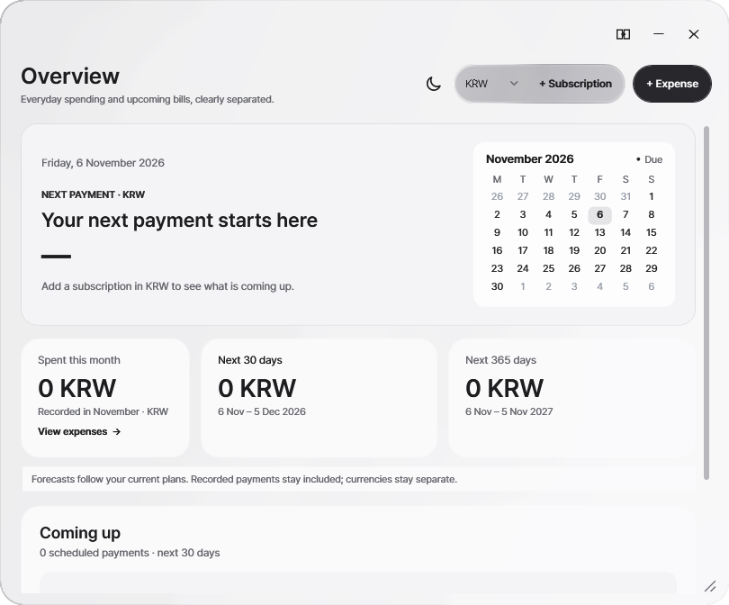

# Tally
### Your spending. Your day. Your own space.

A local-first Windows workspace for expenses, subscriptions, daily tasks, notes and collections — with a small desktop companion and a calm, customizable interface.

**No account · No required cloud service · Portable or installed · Your data stays local**

[**Download Portable ZIP**](https://github.com/memeseonew-eng/Tally/releases/download/v0.5.11-preview.25/Tally-Portable-v0.5.11-preview.25-win-x64.zip) · [**Download Windows Setup**](https://github.com/memeseonew-eng/Tally/releases/download/v0.5.11-preview.25/Tally-Setup-v0.5.11-preview.25-win-x64.exe) · [Release notes](RELEASE_NOTES_PREVIEW25.md) · [All versions](https://github.com/memeseonew-eng/Tally/releases)

**Current public build: 0.5.11-preview.25 · Windows x64 · Unsigned prerelease**

## A useful base, without a wall of options

Tally started with a simple question: *What did I actually spend, and what is coming next?* It now also makes room for the tasks, notes and small collections that live around that question. Start with the essentials. Open the other workspaces when they are useful; optional customization stays out of the default flow.

| Workspace | What it does |
| --- | --- |
| **Expenses** | Record purchases, search and filter transactions, review Week/Month/Year totals, category summaries and local receipt photos. |
| **Subscriptions** | Keep recurring schedules and upcoming charges visible. Record a payment explicitly, or archive and restore a plan. |
| **Daily** | Capture tasks, choose due dates, see what needs attention today, complete or archive items, and track progress. |
| **Notes** | Write local documents in tabs, organize them in folders, move notes by drag and drop, and import/export text or Markdown files. |
| **Collections** | Keep lists, wishes, goals and things you are waiting on together, with icons, details, review dates and local attachments. |
| **Desktop widget** | Check the essentials, capture a quick note, or manage a record without leaving a large window open. |

**Actual spending and scheduled forecasts remain separate.** A predicted bill is never silently marked paid, and currencies are never silently converted or combined.

## A workspace that moves with you

Keep navigation and content together, or separate them into two independently movable cards. Drag the blank upper area of a card to move it; resize a separated card from its bottom-right handle.

To join them again, use the join button or bring their facing left/right edges close together. A soft, text-free frosted preview appears. Hold briefly, then release to confirm. Passing by, dropping quickly, moving away or pressing Escape will not force a join.

- **Small navigation X:** rejoins the cards.
- **Large workspace X:** hides only the large workspace. Selecting a menu item brings it back with a short upward reveal.
- **Quit Tally:** exits the whole application, including its companion/tray presence.

The default full window is **1040 × 700 logical units** — approximately **1300 × 875 pixels at 125% Windows scaling**. Text size is not reduced to make the window smaller. Light/dark themes, local wallpapers and optional appearance controls share the same visual language. Motion is brief and interruptible; Windows animation and high-contrast choices are respected by the motion policy.

> **Not included in this build:** remembering separate window positions across a complete application restart. This remains in the next development candidate and is deliberately not advertised as shipped.

## Keep your day close

Daily is a focused task space, not another financial ledger. A due date is optional. Today brings together open and due tasks, while completion and archive actions stay explicit.

## Notes that belong to you

Keep multiple documents open, arrange folders and attach reference files. Text/Markdown import and export make it easier to take your writing elsewhere. Markdown file support does **not** imply a live Markdown renderer or compatibility with another application's plugins.

## Small collections, real progress

Lists, wishlists, goals and follow-ups have their own lightweight presentations. Choose an icon or a local image, attach related files and keep progress in one place. There is no community plugin marketplace, public automation API or AI service in this release.

<strong>Dark appearance</strong>

## Choose your edition

| | Portable ZIP | Windows Setup |
| --- | --- | --- |
| Best for | A folder you can carry, back up or move | Start-menu and optional desktop shortcuts |
| Start | Extract the **entire** folder, then run `Tally.exe` | Run Setup, then open Tally from its shortcut |
| Private data | `data/` beside `Tally.exe` | `%LOCALAPPDATA%\Tally\data` |
| .NET installation | Not required | Not required |

Both editions include the x64 .NET and Windows Desktop runtime **10.0.14**. The app starts with the desktop widget by default; open the full workspace from the widget/tray, or use `Open-Full-Tally.cmd` in the portable package.

**These editions use separate profiles.** Installing Setup does not automatically import another portable folder's records.

### Update safely

1. Use **Quit Tally**, not just the window X.
2. Back up the **entire** current data folder. The included `Backup-Tally.ps1` helper refuses a live-profile copy.
3. Update program files while preserving your data. Do not replace your existing `data/` folder with an empty one or merge two independently edited databases.

Setup retains `%LOCALAPPDATA%\Tally\data` when uninstalling. Backups should include SQLite/WAL sidecars, notes, tasks, collections, attachments, wallpaper copies, settings and recovery files — not only the spending database.

See [USAGE.md](USAGE.md) for pane behavior, profiles, backups and troubleshooting.

## Trust, status and limitations

This is an **unsigned evaluation build**, not a final stable release. Windows may warn about an unrecognized publisher. Compare the downloaded file with [SHA256SUMS.txt](https://github.com/memeseonew-eng/Tally/releases/download/v0.5.11-preview.25/SHA256SUMS.txt), and keep your security protections enabled.

The public packages contain the exact application DLL previously qualified as Preview25. Qualification includes 1,161 UI checks, pane-geometry checks and real-pointer checks on Windows 11 x64 at 125% scaling. Packaging was separately checked by extracting and hashing every portable file. Installer compilation is verified; fresh install/uninstall testing for this packaging run was not performed while a personal Tally session was running.

Other Windows versions, GPUs, mixed-DPI monitors and complete accessibility coverage are not comprehensively certified. Windows 10 is permitted by the installer, but that is not a claim of fresh Windows 10 testing.

The legacy in-app beta download shortcut may still open the older Beta2 page. That page now points to this release; the download buttons at the top of this README always name the current public package. Updates remain manual. There is no bank connection, automatic currency conversion or built-in cloud synchronization.

## Feedback and project boundaries

[Report a bug](https://github.com/memeseonew-eng/Tally/issues/new/choose) with the build number, display scale, the steps taken and a redacted screenshot. Never upload your data folder, receipts, recovery ZIP, credentials or private notes.

**This public repository is a product/download site, not the application source repository.** It contains binaries, documentation and synthetic demonstration screenshots. Original C# source, WPF design resources and development Git history are not published. See [LICENSE.txt](LICENSE.txt), [THIRD-PARTY-NOTICES.txt](THIRD-PARTY-NOTICES.txt) and [SECURITY.md](SECURITY.md).

All screenshots in this README use synthetic test/demo records, not personal user data.
