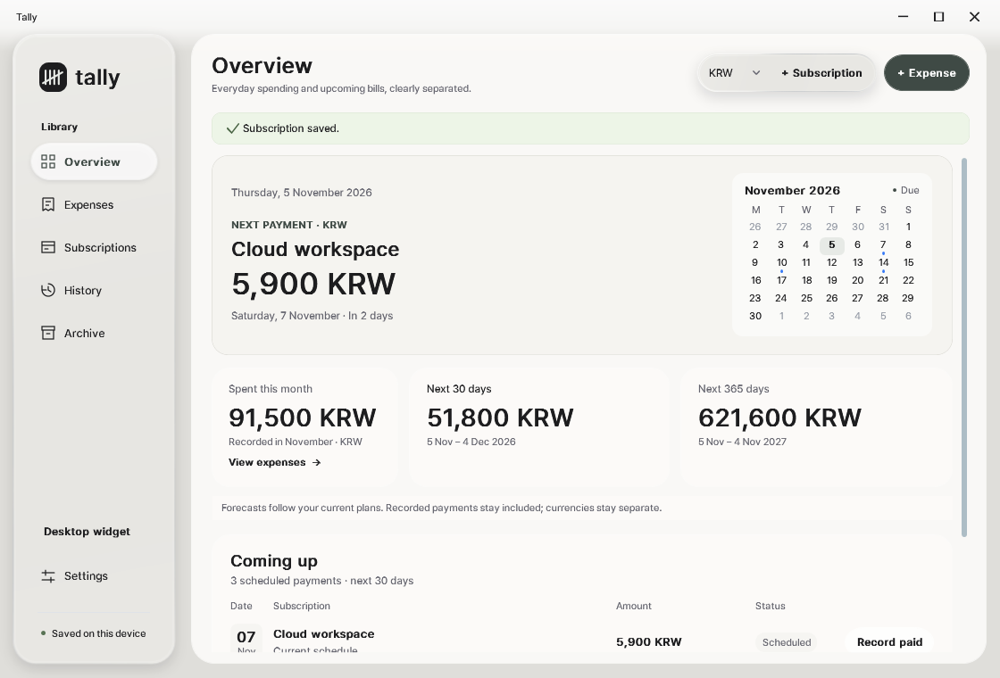
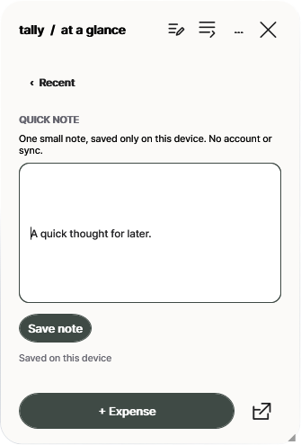
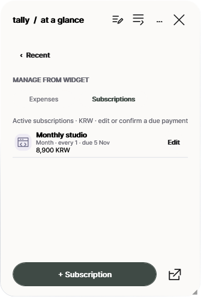
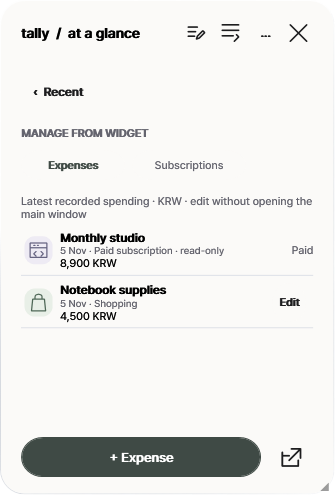

# Tally
**Your spending, without the noise.**

A calm, local-first Windows spending journal, subscription tracker, and desktop companion. Start with a small widget. Open the full workspace only when you need it.

**Windows 10/11 x64 · Offline-friendly · No account · No bank connection · Beta 2**

## Download Tally Beta 2

| Edition | Download | Where your own records stay |
|:--|:--|:--|
| **Portable ZIP** — extract and launch | [Portable for Windows x64](https://github.com/memeseonew-eng/Tally/releases/download/v0.5.4-beta.2/Tally-Portable-v0.5.4-beta.2-win-x64.zip) | `data/` beside `Tally.exe` |
| **Windows Setup** — installed shortcuts, per-user setup | [Windows Setup for x64](https://github.com/memeseonew-eng/Tally/releases/download/v0.5.4-beta.2/Tally-Setup-v0.5.4-beta.2-win-x64.exe) | `%LOCALAPPDATA%\Tally\data` |

[**What's new in Beta 2**](https://github.com/memeseonew-eng/Tally/releases/tag/v0.5.4-beta.2) · [SHA256 checksums](https://github.com/memeseonew-eng/Tally/releases/download/v0.5.4-beta.2/SHA256SUMS.txt) · [All versions](https://github.com/memeseonew-eng/Tally/releases)

*Beta 2 is unsigned. Windows may warn about an unrecognized publisher. Get it only from our official release, check the SHA256 hash, and keep Windows security enabled.*

---

## Quiet by default. Useful when you need more.

*Actual expenses and future scheduled bills live side by side — but they are never mistaken for the same thing. All images show illustrative synthetic data.*

### One widget for the everyday things

Tally opens to a floating desktop widget with current-month actual spending, your recent purchases, and a quick **+ Expense** action. You can choose a Week, Month, or Year recent-activity view without changing the current-month headline.

**Beta 2 adds small, optional tools in that same widget.** There is no mandatory dashboard or extra setup.

| Quick note | Direct management |
|:--|:--|
|  |  |
| Keep a short, private note on this device. It saves safely without becoming a transaction. | Edit expenses or subscriptions, add a subscription, and explicitly record a due payment without opening the main window. |

Switch between **Manage → Expenses** and **Manage → Subscriptions**, and the single large Add button changes with you. The widget's **×** hides just the widget; Tally stays accessible in the Windows tray.

### Open and close as one continuous gesture

The widget's full-window arrow opens the workspace with a quick, position-linked entrance. Close the workspace using its X and the motion gently returns toward that same widget button. Currency, category, billing-cycle, and calendar lists unfold with restrained motion too.

No excessive bouncing or long loading delays: controls remain clickable, keyboard navigation works, and Windows reduced-motion and high-contrast settings are respected. The widget is a regular independent WPF window, not an Explorer desktop injection.

### See what you've actually spent

*Week, Month, and Year recorded spending; separate currencies, clear categories, and a searchable ledger.*

- Add, edit, and find everyday expenses; use 27 category presets including Game, or create your own.
- Attach up to three local photos or receipts to a transaction.
- Keep paid subscriptions in your actual expense history **only after** you confirm a real payment.
- View category insights as an option; keep simple defaults intact.

### Plan subscriptions without inventing payments

Track recurring subscriptions and forecast the next 30 or 365 days. Scheduled costs are not silently treated as settled payments. Use **Record paid** intentionally, with confirmation and duplicate protection. Older payment records are preserved through subsequent subscription edits or archiving.

### Personalize it — or leave it alone

*Neutral glass is the default. Custom backgrounds, accents, widget text, badges, and saved looks are optional.*

Choose a local wallpaper, adjust blur and panel opacity, tweak the accent, personalize the widget title, and save up to eight visual looks. **Use base design** returns to the understated original.

### Everything lives on your computer

Your expenses and subscriptions are stored in local SQLite alongside optional note, appearance, and photo files. No online account, bank login, cloud sync, exchange-rate guessing, or background update polling is required.

Tally takes recovery backups before protected removals. After quitting the app, you can run the included **Backup-Tally** helper to preserve the *entire data folder*, including local photos and preferences.

## Install, upgrade, and protect your data

**Portable:** Extract the whole ZIP to a writable folder, then run `Tally.exe`. For a manual update, quit Tally first, keep your `data/` folder intact, and replace only application files. `Open-Full-Tally.cmd` opens the complete workspace directly.

**Setup:** Install for your Windows account without an administrator requirement. Your files stay at `%LOCALAPPDATA%\Tally\data`, outside the application directory. Uninstalling does not delete that folder. Update using the new Setup after quitting Tally.

**Switching editions or PCs?** Quit both, back up the *whole* data folder, and copy it to the destination. Do not combine independently edited SQLite databases or overwrite newer transactions with an older copy.

Tally's **Settings → Additional · Beta & updates** section contains the installed version, this release, and release history links. Updates are manual.

## A few important limits

This is an early, unsigned Windows x64 beta. There is no automatic bank-transaction detection, foreign-exchange conversion, built-in account/cloud syncing, certified reminders, or guaranteed Win+D persistence. Multi-monitor and mixed-DPI behavior are not fully certified.

Report bugs through [GitHub Issues](https://github.com/memeseonew-eng/Tally/issues), but **never attach your actual `data/` folder, private receipts, real banking records, or private developer archives**.

## License

The public repository is a **binary download and product-information hub, not an open-source code repository**. Original application code and assets are proprietary; see [LICENSE.txt](LICENSE.txt). Third-party .NET and SQLite packages retain their respective licenses; see [THIRD-PARTY-NOTICES.txt](THIRD-PARTY-NOTICES.txt).

© 2026 Tally contributors. All rights reserved.
