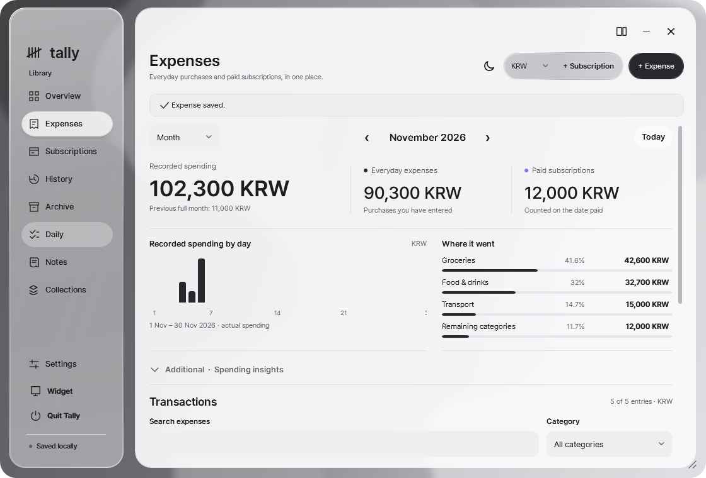
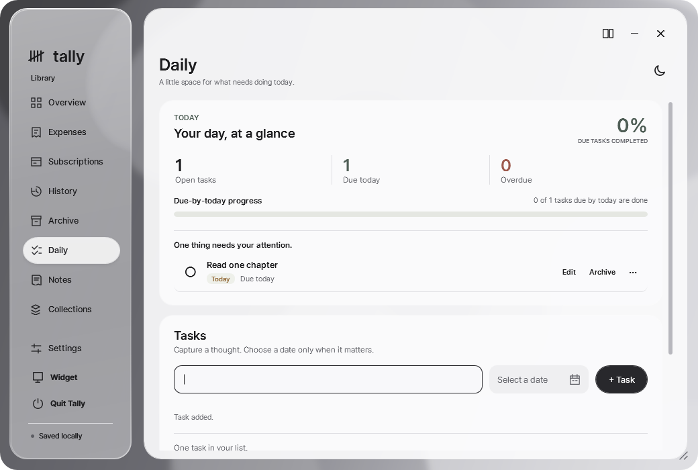
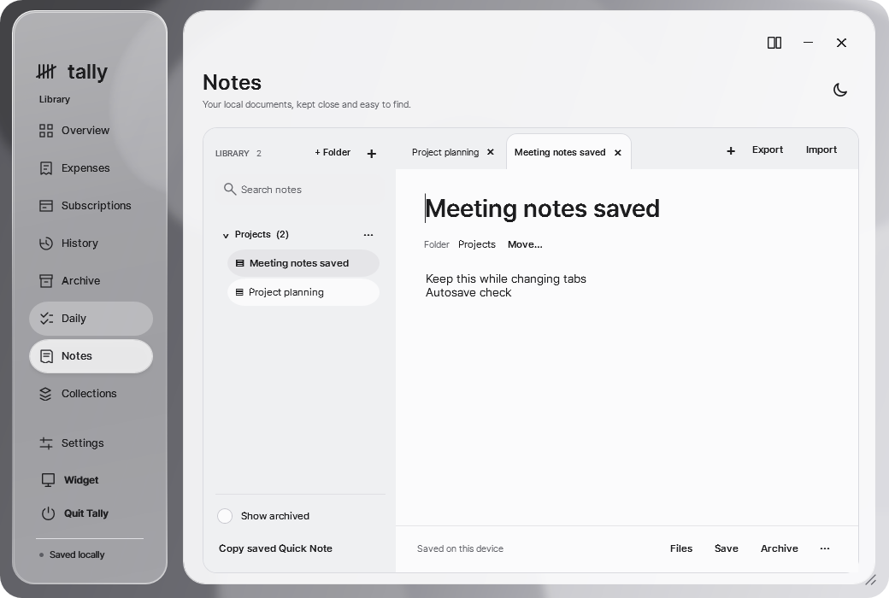
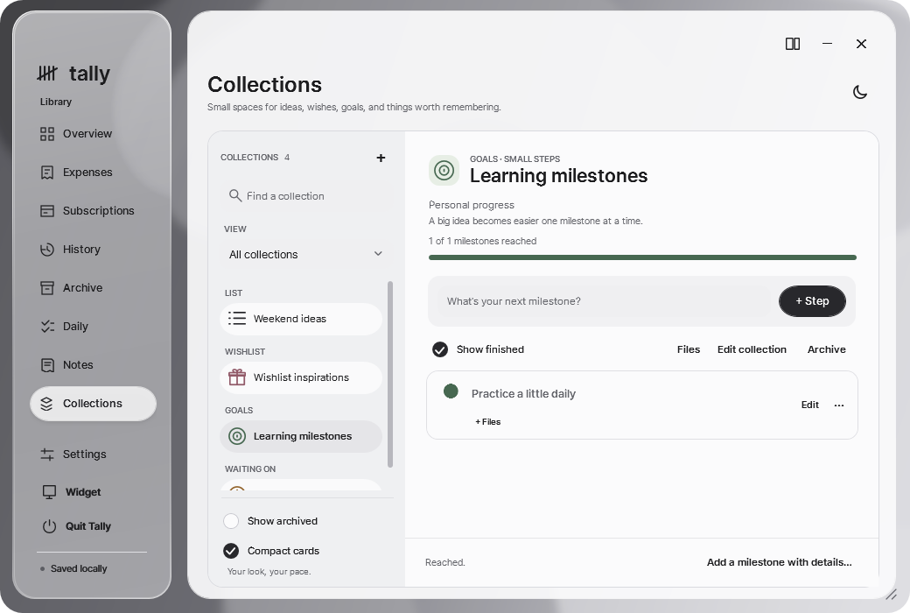
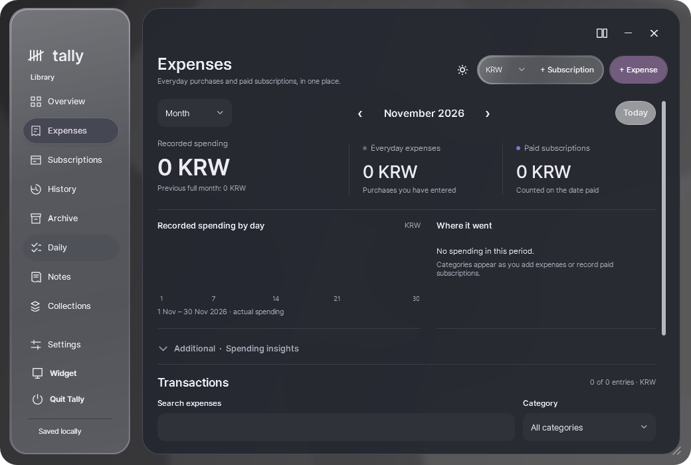

# Tally

### Your spending. Your day. Your own space.

Tally is a local Windows workspace for expenses, subscriptions, daily tasks, notes and collections. A small desktop widget keeps the essentials close, while the full workspace gives you room to organize, review and write.

**No required account · No required cloud service · Portable or installed · Local data**

[Portable ZIP — Preview33](https://github.com/memeseonew-eng/Tally/releases/download/v0.5.11-preview.33/Tally-Portable-v0.5.11-preview.33-win-x64.zip) · [Windows Setup — Preview33](https://github.com/memeseonew-eng/Tally/releases/download/v0.5.11-preview.33/Tally-Setup-v0.5.11-preview.33-win-x64.exe) · [All published versions](https://github.com/memeseonew-eng/Tally/releases)

**Current preview: 0.5.11-preview.33 · 2026-11-07 · Windows x64 · Unsigned prerelease**

[Usage guide](USAGE.md) · [What changed since Preview27](RELEASE_NOTES_PREVIEW33.md)

*Screenshots below are existing product illustrations with synthetic records, not new Preview33 acceptance captures.*

## What you can do

| Workspace | Useful for |
| --- | --- |
| Expenses | Recording purchases, reviewing actual spending, finding transactions and keeping receipt/reference files. |
| Subscriptions | Seeing recurring schedules, recording payments explicitly and keeping payment history. |
| Daily | Capturing tasks, choosing optional due dates and reviewing what needs attention. |
| Notes | Writing local documents in tabs, organizing folders and exchanging TXT/Markdown files. |
| Collections | Keeping lists, wishes, goals and follow-ups together with their details and attachments. |
| Desktop widget | Checking recent spending, capturing a quick note or task, and managing records without leaving a large workspace open. |

Start with the areas you need. Optional insights and appearance controls stay out of the main flow until you open them.

## Understand what you actually spent

An expense is a recorded purchase with a name, amount, currency, date and category. Add notes when useful, choose a familiar category or type your own, and keep receipts or reference documents alongside the entry.

The Expenses workspace gives you Week, Month and Year views. Recorded totals, the spending chart and category shares cover the selected period and currency. The transaction search and category filter narrow the rows below; they do not silently change those whole-period summaries.

Open **Additional · Spending insights** for the average recorded entry, largest entry, days with recorded spending and top category. **Copy period summary** places a text summary on your clipboard for your own records.

A subscription payment appears in Expenses only after you explicitly record it as paid. Its saved amount, currency, name and date remain a record of that payment even if you later edit the subscription. Linked payment entries offer **Undo paid** rather than ordinary expense editing.

**Currencies stay separate.** Tally does not download exchange rates or silently combine currencies. A scheduled bill is a forecast, not proof that money has been paid.

## Keep subscriptions understandable

Save a recurring service with its amount, currency, billing interval, first billing date, category and optional notes. Overview shows upcoming scheduled payments and projected costs.

Use **Record paid** when you have actually paid an occurrence. Tally records the payment and its associated spending explicitly; repeating the same recording does not create a second expense for the same occurrence. **Undo paid** reverses the active payment record while retaining the change in history.

**Archive** pauses a subscription's future forecasts and keeps its history. **Restore** resumes the current schedule. Archiving a record in Tally does not cancel a service with its provider.

Destructive removal requires confirmation and a successful recovery snapshot. Saved spending and history have their own retention rules; removing a subscription is not a command to erase all evidence of what you paid.

### Arrange lists for the way you work

Drag ordering is available in the Transactions and active Subscriptions lists. Drag the non-button area of a row toward another row to place it before or after that row. Action buttons keep their normal behavior.

During a drag, the lifted row retains its original shape and content. A soft shadow and the movement of neighboring rows make the insertion point clear.

The saved order is presentation metadata. It does not edit spending dates, amounts, payment links, financial history or the chronological buckets used in charts. Searching or switching period/currency does not erase the saved order of hidden records.

## Keep your day close

Daily is a separate task workspace. Capture a task with a title and an optional due date, review open tasks, and mark work complete when you finish it. Completed tasks can be reopened; archived items remain available through the archive controls.

Today highlights open, due-today and overdue work. Its progress reflects the recorded due-by-today tasks. An empty set does not receive an invented perfect completion score. The optional seven-day view groups tasks by due date; it is not a completion-time activity history.

Choose the available compactness, accent and progress options when they help you. Task operations do not create financial expenses or mark subscriptions as paid.

The widget's Daily mode provides quick capture and a short preview of due and other open tasks. Use **Open full Daily** when you need the complete list.

## Write and organize local Notes

Notes provides multiple open documents, a searchable library and named folders. Create a folder explicitly, use **Move** to choose a destination, or drag a note onto an existing folder. Drop near the top or bottom edge of another note in the same folder to reorder the library; drop in its center to offer the named-folder creation flow. Escape cancels. Ctrl+Shift+Up/Down moves a focused note among the visible notes in its folder. These actions do not reorder document tabs or change document text.

Keep reference attachments with a note without moving the original source files. TXT and Markdown imports create local documents. Real TXT/Markdown files dropped from Explorer are supported; a link from another application is not automatically the document's contents.

Use the document actions to export one note as TXT or Markdown, or export a folder/all notes as a ZIP of text files. TXT preserves the note body; Markdown includes a document heading and the body. These exports help you move writing between applications.

The same TXT, Markdown and Delete actions are available from a note's library row and its top document tab. Right-click the tab title, blank padding or close-button area, or use **Shift+F10** while the tab control is focused. Opening the menu alone keeps the current editor in place; an action targets the note whose menu you opened.

**The ordinary tab X closes a tab. Delete removes a saved note after confirmation and recovery protection.** A failed save does not silently discard the open draft.

Markdown file support does not imply a live Markdown renderer, plugin compatibility or automatic Obsidian vault synchronization. If another application supplies an Obsidian deep link instead of a real file, select the actual Markdown file for import.

## Give small collections a useful home

Create a named collection with a short description and one of four purposes:

| Purpose | What completion means |
| --- | --- |
| List | Mark an item Done. |
| Wishlist | Mark an item Acquired. |
| Goals | Mark a milestone Reached. |
| Waiting On | Mark a response, delivery or follow-up Resolved. |

Add items quickly, then open their details when needed. An item can have notes, an optional web reference and an optional date to check again. Web references open only when you choose to open them.

Choose a built-in icon or a local photo icon, add managed attachments, and use the available accent/density controls. Progress comes from the items you actually mark; acquiring a wishlist item does not automatically record a financial purchase.

Photo icons, entry covers and attachment thumbnails keep their pictures within the intended rounded surfaces.

Archive a collection to keep it without continuing to edit it. Restore it when useful. Confirmed deletion uses recovery protection, including for archived collections.

## A desktop companion that stays small

The widget opens by default. Money mode shows recorded spending and lets you choose Week, Month or Year for recent activity. Optional category and upcoming-bill details can be enabled from its menu.

The small **Quick note** area is a separate scratchpad, useful for a thought you want to keep nearby. It saves after a short pause and protects an unsaved draft when you switch views. It is distinct from the full Notes document library.

**Manage** gives access to expenses and subscriptions through the same existing editors. Its main add button follows the selected section. Daily mode offers quick task capture and completion; its add action creates a task.

Open the full workspace from the widget or tray. Closing the widget hides that companion while the tray remains available. **Quit Tally** exits the application completely.

## A workspace you can arrange

Keep Navigation and Workspace together or split them into two movable cards. Drag their blank upper caption areas; buttons retain their own click targets. Separated cards can be resized from the bottom-right handle.

To join the cards, use the explicit Join control or bring their facing left/right edges together, pause until the frosted cue is ready, then release. Passing by, releasing too soon, moving away or pressing Escape cancels the join.

- **Navigation X** hides the separated Navigation card. Use the small recall action in Workspace to show it again at its saved position.
- **Workspace X** hides the large workspace. Select a navigation item or use the widget/tray launcher to return.
- **Join** combines the cards. Hiding either card does not perform a join.
- **Quit Tally** closes the whole application after pending-save and busy checks permit it.

Joined/separate positions, sizes and hidden-pane state are remembered. If a saved monitor position becomes inaccessible, the workspace has recovery behavior to bring the window back into reach.

The default full window is 1040 × 700 logical units, approximately 1300 × 875 physical pixels at 125% scaling. Text is not reduced to force the workspace into a smaller window.

## Make it your own

Use light or dark appearance, choose a local wallpaper, and adjust the available background/material controls. Managed wallpaper copies let the app retain its background after the original selected file moves.

The widget offers compact mode, optional recent/category/upcoming content, keep-on-top and position locking. Additional style controls are optional. Saved appearance choices remain separate from financial records.

Brief, consistent motion is used for Notes action menus, Money/Daily and recent-period transitions, list dragging, spending/category/task progress, expandable insights, command feedback and guarded Quit. Numeric values and commands remain immediate; decorative motion does not change financial facts or native window placement. Windows animation and high-contrast policy govern decorative motion. Command-result notices, including unsuccessful results, dismiss automatically after a brief interval. A newer result receives its own interval. Expiry does not discard a draft or turn a failed operation into a successful one. Unresolved validation, blocked refresh and unsaved-state explanations remain available until addressed.

## Files stay with the relevant record

Expenses, Notes and Collections support a shared local attachment experience. Supported reference types include safe images, PDF, TXT, Markdown, CSV and validated Office document containers. Existing receipt-photo storage remains available.

Files are copied into managed local storage; adding an attachment does not delete the original. Open an attachment explicitly, export an individual file or make an attachment ZIP when you need a copy elsewhere. Managed attachments and photo icons belong in your complete profile backup.

An exported note-text ZIP is a convenient interchange format. It is not a complete database, attachment or application-settings backup.

## Choose an edition

| | Portable ZIP | Windows Setup |
| --- | --- | --- |
| Getting started | Extract the entire folder, then run Tally.exe. | Run Setup and use its shortcut. |
| Best fit | A writable folder you can move or carry. | Per-user installation and optional desktop shortcut. |
| Private data | data/ beside Tally.exe. | %LOCALAPPDATA%\Tally\data. |
| Separate .NET installation | Not required for the self-contained package. | Not required for the self-contained package. |

Do not run the application from inside its ZIP. Keep the whole program folder together; Tally.exe alone is not the complete runtime. The portable package also offers Open-Full-Tally.cmd to open the full workspace directly.

**Portable and Setup use separate profiles.** Installing Setup does not automatically import the records in another portable folder. Settings & help identifies the active data location.

Both editions bundle the x64 .NET and Windows Desktop runtime **10.0.14**.

## Update and back up safely

1. Choose **Quit Tally**. Closing a window or hiding the widget is not a complete exit.
2. Back up the entire current profile to a private location. The included Backup-Tally.ps1 helper refuses a live-profile copy and verifies the contents it archives.
3. Preserve the backup, then replace program files without overwriting your data with an empty profile.
4. Reopen the same profile and verify your records. Do not merge two independently edited databases.

A complete profile includes financial, Daily and Collections databases and their SQLite sidecars, notes, receipts, attachments, photo icons, wallpaper copies, preferences and recovery records. Copying only tally.sqlite is not a whole-workspace backup.

Setup is configured to retain its per-user data folder on uninstall. This retention rule has static qualification; fresh install/uninstall execution is **NOT_RUN**. Keep your own verified backup.

A private developer/source recovery ZIP is a different artifact: it contains code, Git history, application binaries and development instructions. It deliberately excludes personal profiles. Neither source Git history nor note exports substitute for a personal-data backup.

## Release status, trust and feedback

Tally is an unsigned prerelease. Windows may show an unrecognized-publisher warning. Verify downloads against the checksum list from the same official release and keep your security protections enabled.

[Preview33 checksums](https://github.com/memeseonew-eng/Tally/releases/download/v0.5.11-preview.33/SHA256SUMS.txt)

## Release verification and scope

**Version 0.5.11-preview.33 · 2026-11-07 · Windows x64**

| Evidence | Result |
| --- | --- |
| Automated WPF application checks | 1,635 passed; zero binding errors |
| Native widget, menu, notice, insights and Quit checks | 10 passed |
| Native pointer reorder, cancellation and restart checks | 17 passed |
| Application DLL SHA256 | `459A6F484FF9998319FB85EBD453AFF5B0D99DF459538B40E46F0B2090582FA4` |
| Recorded native environment | Current Windows 11 x64 device, 96 DPI (100% scaling). |
| Setup qualification | Compilation and static package/retention checks only. Fresh install/uninstall execution: **NOT_RUN**. |

Native Quit checks confirm guarded exit. PrintWindow captures do not certify the full compositor fade or exact visual timing.

Results apply to the recorded scenarios and exact release program set. Other Windows versions, GPUs, physical mixed-DPI monitor arrangements, complete accessibility coverage and long-running environmental behavior are not certified by these checks. Compilation and static inspection are not fresh installer execution.

Updates are manual through the official release page. There is no bank connection, automatic currency conversion, built-in cloud sync, external plugin marketplace or public automation API. US stock charts remain research, not a feature in this package.

[Report a bug](https://github.com/memeseonew-eng/Tally/issues/new/choose) with the build number, display scale, theme, a short reproduction sequence and a redacted screenshot. Never upload your profile, private notes, receipts, developer recovery ZIP, credentials or access tokens.

**This public repository is a product/download site, not the private application source repository.** It contains public documentation, release metadata, synthetic screenshots and binary downloads. Private C#/XAML sources and development Git history are not published.

See LICENSE.txt, THIRD-PARTY-NOTICES.txt and SECURITY.md for terms, included software and safe reporting. Demonstration screenshots use synthetic records and illustrate the established product.
