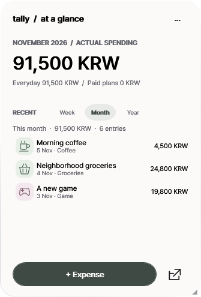
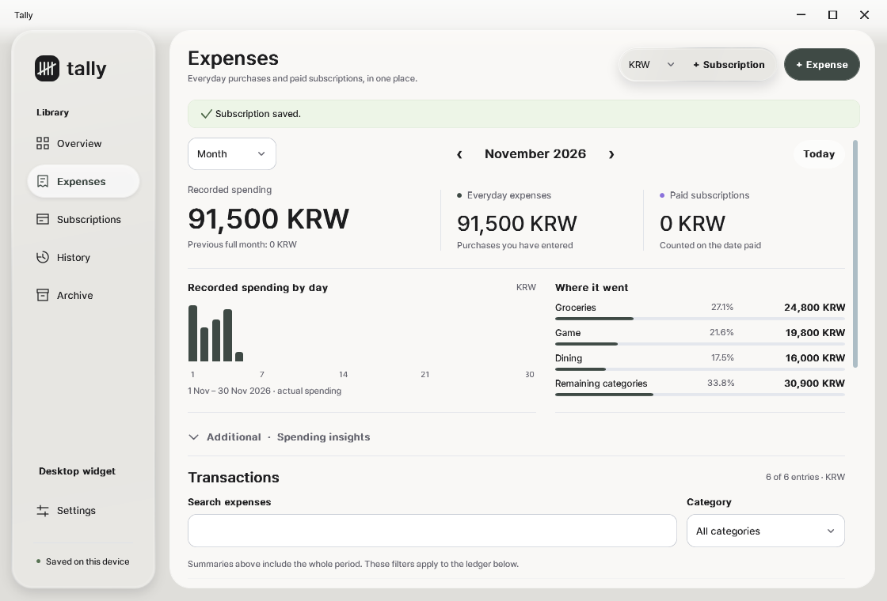
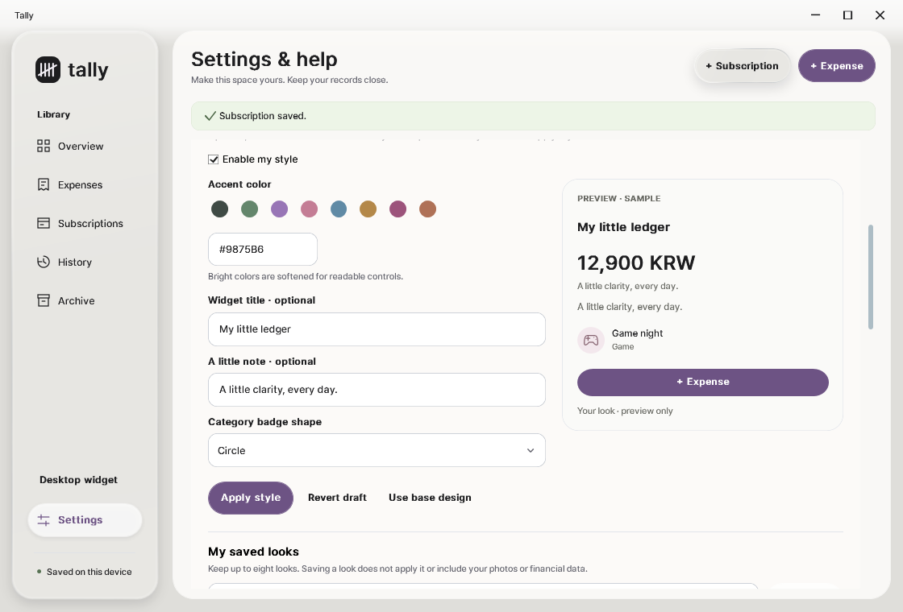
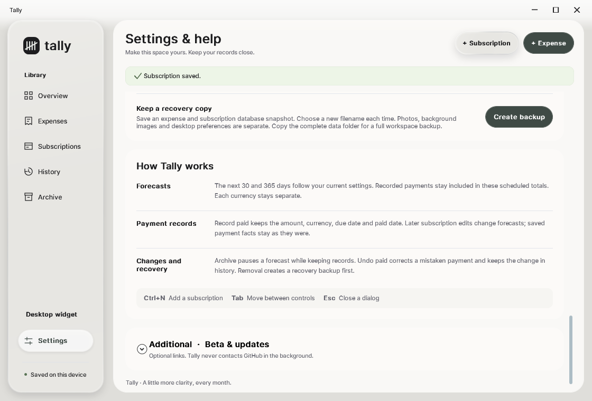

# Tally 0.5.0 Beta 1 — A Little More Clarity

**Tally is now available as its first public Windows beta.**

A spending journal, recurring-cost tracker and tiny desktop widget built around one idea: **keep money visible without turning your day into accounting software.** It's private, local-first, and deliberately calm until you decide to make it your own.

## Two ways to get started

- **Portable ZIP:** [Tally-Portable-v0.5.0-beta.1-win-x64.zip](https://github.com/memeseonew-eng/Tally/releases/download/v0.5.0-beta.1/Tally-Portable-v0.5.0-beta.1-win-x64.zip) — extract into a writable folder and run Tally.exe. Your `data/` folder stays beside the app.
- **Windows Setup:** [Tally-Setup-v0.5.0-beta.1-win-x64.exe](https://github.com/memeseonew-eng/Tally/releases/download/v0.5.0-beta.1/Tally-Setup-v0.5.0-beta.1-win-x64.exe) — current-user installation, shortcuts, no administrator requirement. Data lives at `%LOCALAPPDATA%\Tally\data` and is preserved when uninstalling.
- **Integrity:** [SHA256SUMS.txt](https://github.com/memeseonew-eng/Tally/releases/download/v0.5.0-beta.1/SHA256SUMS.txt)

**System:** Windows 10/11 x64, self-contained .NET 10 / Windows Desktop 10.0.14. Internet is not required for Tally's everyday features.

## The features worth trying

### 1. A widget that lets you get back to what you were doing

Start with current-month recorded spending and the last few expenses. Switch the recent list between Week, Month and Year, add a purchase instantly, or open the full window with one click. In the small `...` menu you can *optionally* show upcoming bills, top categories, five entries, pin or compact the widget. **Hide widget never unexpectedly opens the full app.**

### 2. Expenses and plans, separate but connected

Track ordinary spending in Week/Month/Year views, group by category, and attach up to three photos per expense. Keep subscriptions and upcoming scheduled payments visible without treating them as money already paid. Record paid manually; historical paid amounts and dates survive later subscription edits.

### 3. A simple base. A personal space if you want it.

The default neutral, frosted interface is intentionally restrained. The optional Style Studio offers curated accents or a hex color, widget title/note, icon badge shapes and saved looks. Wallpaper images, adjustable blur and opacity are separate from your expense data. **Use base design** resets optional styling without throwing away your saved presets.

### 4. One local data folder; recovery on your terms

No bank login. No account. No hidden synchronization. Your ledger is SQLite, with photo/appearance sidecars in the same data folder. Tally provides a database snapshot and creates recovery backups before certain destructive actions. The bundled `Backup-Tally.ps1` makes a full folder ZIP *after you quit Tally*, preserving receipts and customizations as well.

## Beta 1 highlights / change log

- Public x64 portable build and current-user Windows installer.
- Widget-first startup with one-click full window and correct tray-only hiding.
- Recorded Expenses by Week, Month and Year, 27 icon categories, search and category totals.
- Week/Month/Year recent-activity widget, optional upcoming bills/category breakdown.
- Manually recorded subscription payments, actual vs. projected totals, per-currency precision.
- Local photos/receipts, history, recovery snapshots and full-folder backup helper.
- Original neutral glass-inspired interface, optional backdrop and blur, Style Studio and saved looks.
- Manual release/version links under collapsed Settings → Additional · Beta & updates.

## Privacy, migration and limits

**Do not include your `data/` folder in a public report.** The installed version uses a different location from the portable edition: quit both apps and copy the **entire** data folder when migrating. Do not combine independently edited databases or replace newer entries with older backups.

This beta does not connect to banks, auto-detect payments, provide FX conversions, cloud sync, automatic update checks, or production-grade installer signing. Windows may warn about an unrecognized publisher because the EXE is unsigned. **Verify the published SHA256** and never disable Windows security to install software from an unknown source.

All screenshots show **illustrative synthetic demo data**, not user accounts. The public repository publishes binary downloads, release notes and screenshots only; original Tally source and other proprietary resources are not licensed for reuse or redistribution. Third-party .NET/SQLite software retains its own licenses.

**Thanks for trying Tally Beta 1.** Feedback: [GitHub Issues](https://github.com/memeseonew-eng/Tally/issues) · [All versions](https://github.com/memeseonew-eng/Tally/releases)
