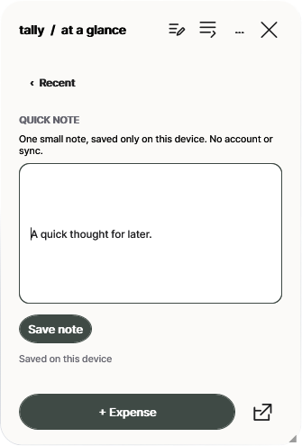
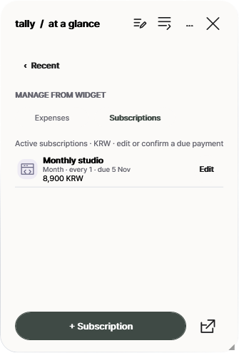
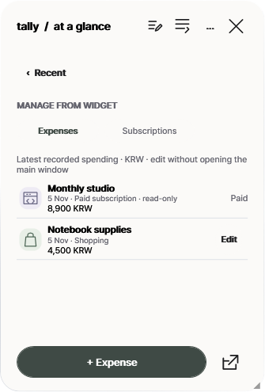
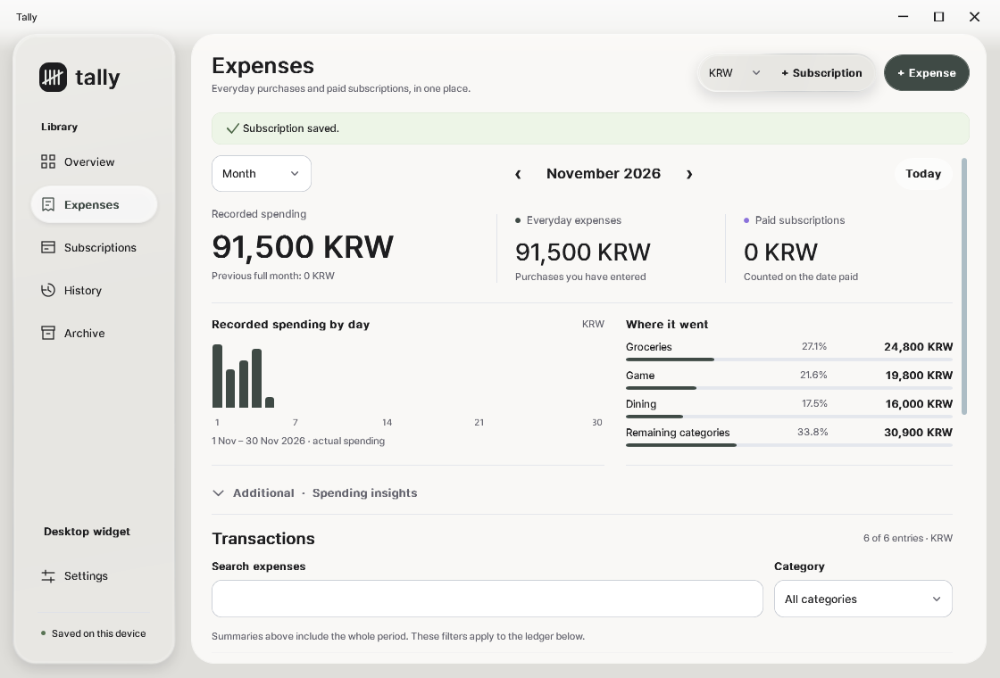

> **A newer public preview is available:** [0.5.11-preview.25](https://github.com/memeseonew-eng/Tally/releases/tag/v0.5.11-preview.25). This page is retained as a historical release record.

# Tally 0.5.4 Beta 2 — Your desktop companion, more complete

**A quieter way to keep track of real spending and recurring plans — now with notes, direct widget management, and natural motion.**

The second public Windows beta expands the small desktop companion without making the default interface more complicated. All existing local records, custom looks, and manual subscription-payment rules remain intact.

## Download for Windows 10/11 x64

- **Portable ZIP:** [Tally-Portable-v0.5.4-beta.2-win-x64.zip](https://github.com/memeseonew-eng/Tally/releases/download/v0.5.4-beta.2/Tally-Portable-v0.5.4-beta.2-win-x64.zip)
- **Windows Setup:** [Tally-Setup-v0.5.4-beta.2-win-x64.exe](https://github.com/memeseonew-eng/Tally/releases/download/v0.5.4-beta.2/Tally-Setup-v0.5.4-beta.2-win-x64.exe)
- **File hashes:** [SHA256SUMS.txt](https://github.com/memeseonew-eng/Tally/releases/download/v0.5.4-beta.2/SHA256SUMS.txt)

Both packages are self-contained with .NET and Windows Desktop runtime 10.0.14; no separate .NET installation is required. There is no account, subscription, cloud service, or bank connection required.

## What's new since Beta 1

### 1. Notes — a little space for the things you don't want to forget

Tap the widget's Notes icon to write a short note (up to 1,500 characters) without entering the full application. Notes are saved locally, use guarded atomic storage, and retain recoverable copies if a file is malformed. No note file is created simply by opening the empty panel.

### 2. Manage expenses and subscriptions without opening a big window

The optional widget Manage view has **Expenses** and **Subscriptions** tabs. Edit an existing record or create a new one using the native editor. The single large action changes automatically between **+ Expense** and **+ Subscription**. A scheduled payment can be marked **Record paid** only with confirmation and duplicate protection. The full main window stays hidden.

### 3. A real one-click widget close

The new **×** at the top of the widget closes only that floating companion. Tally stays in the Windows tray, so it is easy to bring back. Notes are still guarded against unsafe closure when their save fails.

### 4. An interface that feels connected

Opening Tally from the widget's small arrow now uses a brief origin-linked expansion. Closing the full workspace through its X uses a complementary short return toward that same widget button. Currency, category, billing-cycle and calendar lists have gentle, responsive *opening* motion, along with subtle button and tab feedback. Reduced-motion and high-contrast OS settings are respected.

**Important:** Native dropdowns close immediately to preserve keyboard Tab/Escape behavior; an extra closing fade is **not** included.

### 5. Everything you already rely on

- Record and edit spending by Week, Month or Year; search, filter, and view category totals.
- Pick from 27 preset categories (including Game) or enter a custom name; attach up to three local photos per purchase.
- Manage recurring subscriptions, predicted next 30/365-day charges, retained paid records, archive and restore.
- Keep actual expenses separate from scheduled bills. Payments are **never automatically declared paid** and currencies are **never silently converted**.
- Personalize the neutral glass interface only if you wish: local wallpaper, blur/opacity, accents, badge shapes, widget title and saved looks.
- Make full local data backups (including photos and settings) with the included helper after quitting Tally.

## Updating without losing data

**Portable:** Quit Tally from the tray, then replace the old program files with this new ZIP. Keep your complete existing `data/` folder beside the executable; never replace it with an empty folder from a new extraction.

**Setup:** Quit Tally before running the new installer. The application installs per-user; private data remains in `%LOCALAPPDATA%\Tally\data`, and uninstalling the application does not delete it.

Before switching editions or machines, make a complete data-folder backup. SQLite files, receipt photos, notes, background copies and appearance settings all matter. Do not combine two separately edited databases.

## Privacy and limits

Tally remains local-first and does not silently contact banking APIs, upload financial data, sync between devices, calculate FX rates or check for updates in the background. This is an **unsigned early beta**; Windows may show an unrecognized-publisher warning. Verify official file hashes and leave security protections enabled. Mixed-DPI/multiple-monitor use and Win+D persistence remain areas for wider testing.

Every screenshot here shows **synthetic demonstration data**. Do not attach your real Tally data folder, receipts or private development backups to issues.

Tally's public GitHub repository contains downloads, documentation and promotional screenshots only. Original C# source, WPF resources and development Git history are not published.

[All releases](https://github.com/memeseonew-eng/Tally/releases) · [Report an issue](https://github.com/memeseonew-eng/Tally/issues) · [License](https://github.com/memeseonew-eng/Tally/blob/main/LICENSE.txt)
