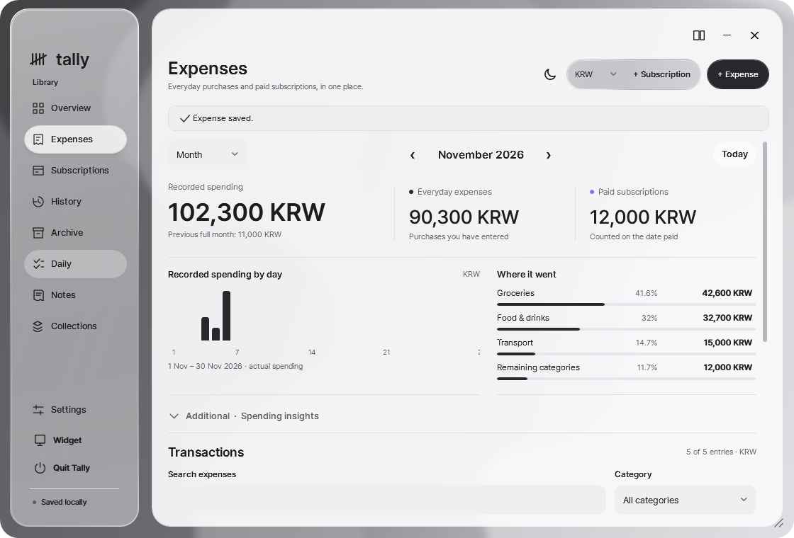
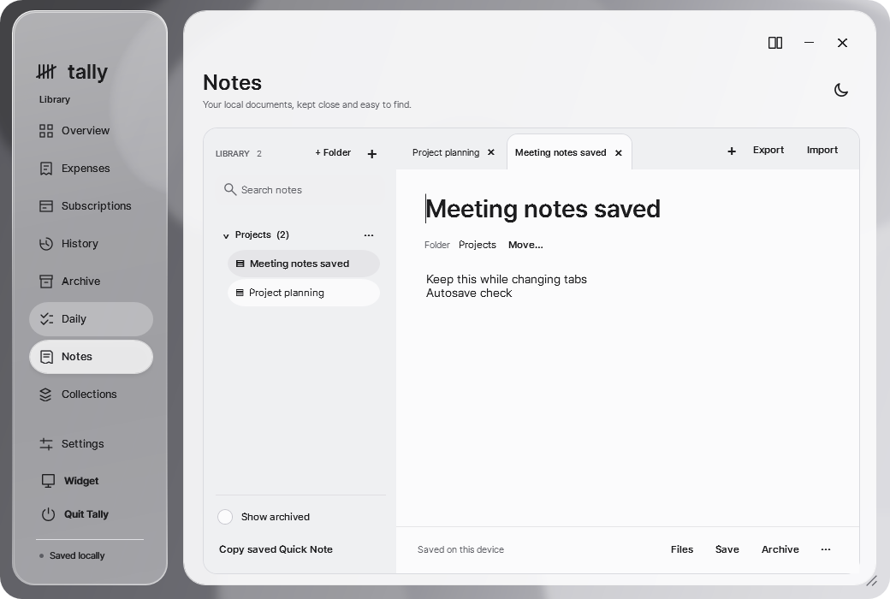

> **Newer release:** [Preview27](https://github.com/memeseonew-eng/Tally/releases/tag/v0.5.11-preview.27) adds minimize/restore motion and verified persistent pane placement. The notes below describe historical Preview25.

# Tally 0.5.11 Preview 25 — A calmer, more flexible workspace

**A local-first place for spending, subscriptions, Daily tasks, Notes and Collections.** This public preview brings together the UI16-qualified application changes since Beta2, without publishing the private application source.

## Downloads

- [Portable ZIP — Windows x64](https://github.com/memeseonew-eng/Tally/releases/download/v0.5.11-preview.25/Tally-Portable-v0.5.11-preview.25-win-x64.zip)
- [Windows Setup — per-user installation](https://github.com/memeseonew-eng/Tally/releases/download/v0.5.11-preview.25/Tally-Setup-v0.5.11-preview.25-win-x64.exe)
- [SHA256 checksums](https://github.com/memeseonew-eng/Tally/releases/download/v0.5.11-preview.25/SHA256SUMS.txt)

Both include .NET/Windows Desktop 10.0.14. This is an unsigned prerelease; verify the checksums and retain your security protections.

## New since public Beta2

### Daily, full Notes and Collections

Daily adds due dates, Today, task completion and archive flows. The full Notes workspace adds document tabs, folders, drag-and-drop organization, attachments and text/Markdown import/export. Collections adds lists, wishes, goals, follow-ups, icons and related files. These sit alongside the existing spending journal, recurring schedules and compact desktop widget.

### Detachable cards, deliberate joins

Navigation and Workspace can separate into independently movable/resizable windows. Place either card beside the other's left or right edge; a soft frosted cue signals the destination. **A stable 440 ms hold followed by release** confirms the join. Passing through, releasing early, moving away or Escape cancels. No permanent Hold labels or docking badges cover your content.

The small navigation X rejoins. The large workspace X hides that workspace without discarding its live document state. Selecting Daily, Expenses or another row restores it with a short rise/fade — even when selecting the same row again.

### More consistent motion, smaller default

The default window is now 1040 × 700 logical units (about 1300 × 875 physical pixels at 125% scaling). Text size is unchanged. All eight base menu routes fit at the new default height. Daily, Notes and Collections animate their actual visible content; selection and hover effects animate material instead of scaling navigation text. Interrupted or disabled button feedback resets cleanly.

### Common fixes, not one-off patches

Owned editors share one transparent rounded silhouette, with stationary exterior chrome during entrance motion. Dark focused fields and subscription header/footer surfaces use theme-aware colors. The small pane's upper blank drag band covers its width. Pane reparenting clears stale tooltip geometry. Below-screen movement, manual resizing and minimize/restore behavior are preserved.

## Included and deliberately not included

**Included:** the exact application DLL qualified as 0.5.11-preview.25, local data handling, deliberate edge joins and the shared editor fixes.

**Not included:** Preview26's persistent joined/separated window positions across a full restart and its additional fast-drag capture handling. That candidate has automated coverage but still needs physical restart/input acceptance. It is not silently bundled into this release. There is no third-party plugin marketplace, public automation API, AI integration, banking connection or cloud synchronization.

## Updating and keeping data

Quit Tally completely first. Back up the **whole** existing data folder. Portable keeps data beside the executable; Setup uses `%LOCALAPPDATA%\Tally\data` and retains it on uninstall. Replace program files only. Never merge two separately edited profiles or replace a populated `data/` folder with an empty extraction.

The included backup helper refuses live-profile copying. A developer source backup is not a substitute for your personal-record backup. See [usage and recovery guidance](https://github.com/memeseonew-eng/Tally/blob/main/USAGE.md).

## Verification and known limits

The exact Preview25 DLL previously passed 1,161 full WPF/UI checks, 175 focused checks, 86 pane-geometry checks, 53 Core, 61 Storage and 91 Daily/Collections checks. Packaged pointer tests covered editor/grip behavior, edge joins, close/reopen, downward movement and resize/restore on Windows 11 x64 / 125% scale.

This publication does not rebuild application code. Debug symbols and private files are omitted. Every extracted portable file is compared with its staged original; release downloads are compared with local hashes. Setup is compiled with the existing per-user AppId/data-retention policy. **Fresh native and installer install/uninstall checks were not run during publication because a personal Tally session remained open.** Other physical DPI/monitor/Windows/GPU combinations are not fully certified.

The legacy in-app beta download shortcut can open Beta2. Its release page now directs users here. Use this release or the current README for exact downloads; there is no automatic updater.

All displayed screenshots contain synthetic demonstration records. Public GitHub contains compiled packages, product documentation and approved screenshots only. Private source, development history, user records and cloud development saves remain private.
